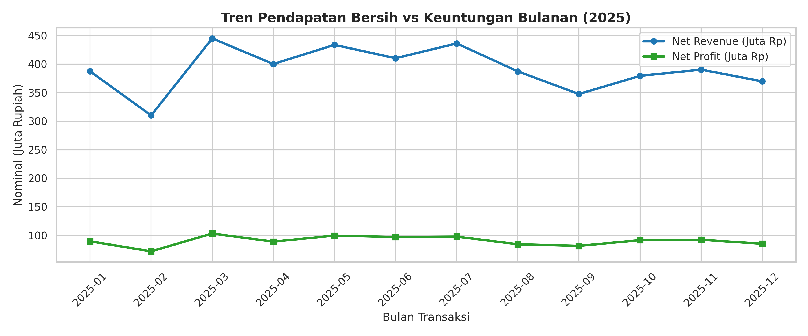
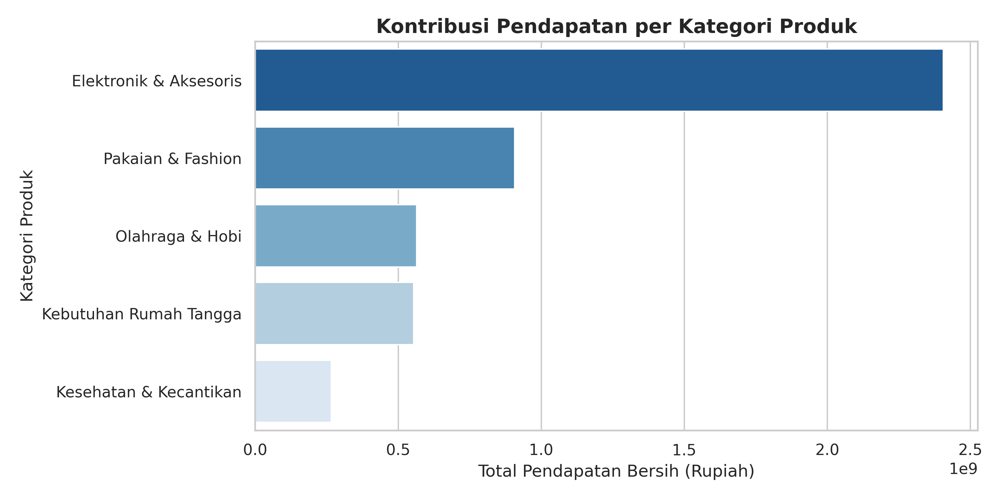
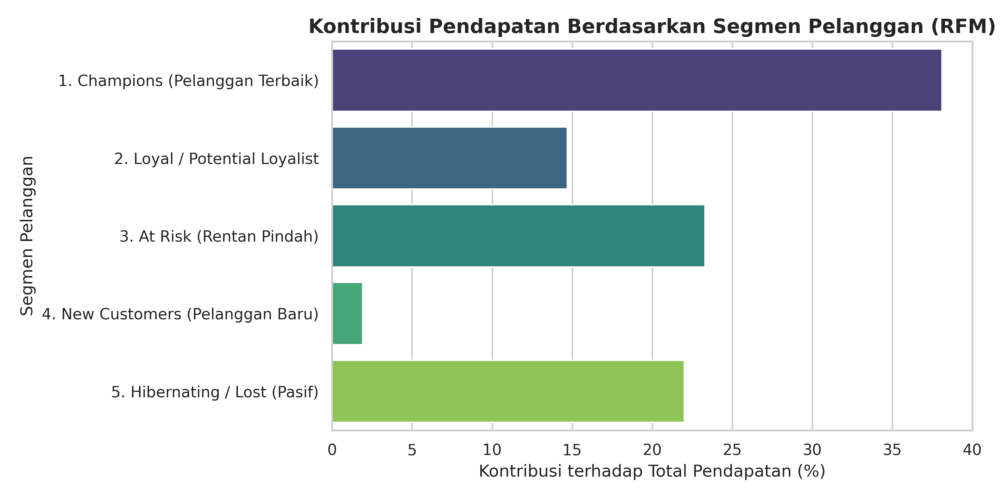

# 🛒 Analisis Profitabilitas Penjualan Ritel & Segmentasi Pelanggan (Metode RFM)

## 📌 Latar Belakang Bisnis (Business Problem)
Perusahaan ritel sering kali hanya berfokus pada peningkatan total nilai penjualan kotor (*gross sales*) melalui pemberian diskon promosi, tanpa menyadari bahwa diskon yang tidak terarah dapat menggerus margin keuntungan bersih (*net profit*). Selain itu, memperlakukan seluruh pelanggan dengan strategi pemasaran yang sama membuat biaya promosi menjadi tidak efisien.

Proyek ini bertujuan untuk:
1. Mengevaluasi **tren pendapatan dan margin keuntungan** di berbagai kategori produk.
2. Menganalisis **dampak kebijakan diskon** terhadap profitabilitas bersih perusahaan.
3. Mengelompokkan pelanggan menggunakan metode **RFM (Recency, Frequency, Monetary)** guna menyusun strategi pemasaran yang tepat sasaran.

---

## 🛠️ Tools & Metodologi
* **Environment:** Google Colab (Python 3)
* **Libraries:** `pandas`, `numpy`, `matplotlib`, `seaborn`
* **Tahapan Analisis:**
  1. **Data Cleaning & Preprocessing:** Menangani *missing values* pada ID pelanggan, menghapus transaksi duplikat, dan menghitung metrik bisnis (*Gross Sales*, *Net Revenue*, *COGS*, dan *Net Profit*).
  2. **Exploratory Data Analysis (EDA):** Analisis tren bulanan, kontribusi kategori produk, dan elastisitas diskon terhadap margin.
  3. **RFM Customer Segmentation:** Pemberian skor kuartil (1–4) pada metrik *Recency*, *Frequency*, dan *Monetary* untuk memetakan pelanggan ke dalam 5 segmen strategis.

---

## 📊 Hasil Analisis & Visualisasi Utama

### 1. Tren Pendapatan vs Keuntungan Bulanan

* Pendapatan dan profit bergerak stabil sepanjang tahun, namun terdapat selisih rasio margin pada bulan-bulan dengan intensitas promo tinggi.

### 2. Performa Kategori Produk

* Kategori **Elektronik & Aksesoris** serta **Pakaian & Fashion** menjadi penyumbang pendapatan terbesar bagi perusahaan.

### 3. Evaluasi Kebijakan Diskon (Temuan Kritis)
Berdasarkan hasil olahan data pada tabel *Discount Impact*:
* Transaksi dengan diskon **0% hingga 10%** menghasilkan margin keuntungan bersih yang sehat (rata-rata margin di atas 18%).
* Sebaliknya, transaksi dengan **diskon 30%** justru menghasilkan **Net Profit negatif (rugi)** karena potongan harga melebihi batas margin Harga Pokok Penjualan (COGS 72%).

### 4. Segmentasi Pelanggan (RFM Analysis)

* **Champions (Pelanggan Terbaik):** Meskipun jumlahnya hanya sebagian kecil dari total populasi pelanggan, segmen ini menyumbang porsi pendapatan terbesar dengan frekuensi belanja tertinggi.
* **At Risk (Rentan Pindah):** Kelompok pelanggan yang dulunya aktif berbelanja dalam jumlah besar, namun sudah cukup lama tidak melakukan transaksi kembali.

---

## 💡 Rekomendasi Bisnis (Actionable Insights)

1. **Batasi Diskon Reguler Maksimal di Angka 15%–20%:**
   Hentikan pemberian diskon langsung sebesar 30% pada produk reguler karena terbukti menggerus profit menjadi negatif. Ganti strategi diskon besar dengan sistem *bundling* (paket hemat dengan syarat minimum belanja) untuk menjaga margin keuntungan.
2. **Program Retensi Khusus untuk Segmen "At Risk":**
   Segera kirimkan kampanye *win-back* (seperti voucher pengingat khusus atau katalog produk baru) kepada pelanggan di segmen *At Risk* sebelum mereka sepenuhnya beralih ke kompetitor.
3. **Pertahankan Segmen "Champions" Tanpa Perang Harga:**
   Pelanggan di segmen *Champions* sudah memiliki loyalitas tinggi. Alihkan anggaran diskon pada segmen ini menjadi layanan bernilai tambah, seperti akses produk lebih awal (*early access*) atau poin *membership* VIP.

---

## 📂 Struktur File di Repository Ini
* `Retail_Sales_and_RFM_Analysis.ipynb` — Notebook lengkap berisi kode Python dari tahap pembersihan data hingga pemodelan RFM (bisa dibuka langsung di Google Colab).
* `*.png` — Grafik hasil visualisasi data.
